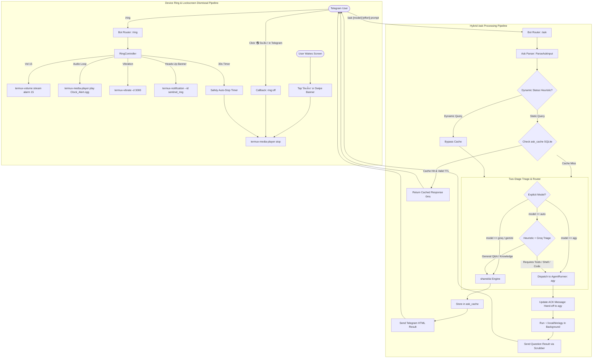

# Pocket Sentinel — Hybrid `/ask` AI Router, Smart Cache, and Device Ringing (`/ring`) Implementation Plan

## 1. Architecture Flow



---

## 2. Module & File Map

| Path | Purpose |
|---|---|
| `shared/db/db.go` | Add SQLite table migration for `ask_cache` with indexes on `prompt_hash` and `expires_at`. |
| `modules/bot/ask_parser.go` | Implement `ParseAskInput()` supporting bracket-free prefixes (`[model]`, `[effort]`), flags (`--no-cache`), and fallback defaults. |
| `modules/bot/ask_parser_test.go` | Unit tests for parser covering all combinations, whitespace, case insensitivity, and legacy bracket format. |
| `modules/bot/ask_cache.go` | SQLite repository for caching queries: `Get()`, `Set()`, `PruneExpired()`, and SHA-256 prompt normalization. |
| `modules/bot/ask_cache_test.go` | Unit tests for cache hits, misses, TTL expiration, and duplicate inserts. |
| `modules/bot/ring.go` | `RingController` hardware controller managing volume, media player, vibration, heads-up notification, 30s auto-off, and thread-safe stop locks. |
| `modules/bot/ring_test.go` | Unit tests for `RingController` lifecycle, concurrent triggers, auto-off timer, and mock execution. |
| `modules/bot/router.go` | Refactor `case "/ask"` to wire Parser → Cache → Triage → Fast LLM / agy. Add `case "/ring"` and callback `ring:off`. |
| `modules/bot/router_test.go` | Router tests for `/ask` fast path, `/ask` delegation path, `/ring` command, and permission gates. |
| `modules/bot/keyboards.go` | Add `[ 🔔 ส่งเสียงหาเครื่อง ]` to `/panel` or helper keyboards, plus `[ 🔇 ปิดเสียง ]` inline markup for `/ring`. |

---

## 3. Database Schema

```sql
CREATE TABLE IF NOT EXISTS ask_cache (
    id INTEGER PRIMARY KEY AUTOINCREMENT,
    prompt_hash TEXT NOT NULL UNIQUE,
    prompt_text TEXT NOT NULL,
    model_name TEXT NOT NULL,
    response_text TEXT NOT NULL,
    created_at DATETIME NOT NULL DEFAULT CURRENT_TIMESTAMP,
    expires_at DATETIME NOT NULL
);

CREATE INDEX IF NOT EXISTS idx_ask_cache_hash ON ask_cache(prompt_hash);
CREATE INDEX IF NOT EXISTS idx_ask_cache_expires ON ask_cache(expires_at);
```

---

## 4. Step-by-Step Implementation Strategy

### Step 1: Database Schema & Migration (`shared/db/db.go`)
- Add `ask_cache` table creation in `InitDB()` with indexes.
- Ensure backwards compatibility with existing database files.

### Step 2: Bracket-Free Parser (`modules/bot/ask_parser.go`)
- Parse leading tokens:
  - Model aliases: `auto`, `groq`, `gemini`, `openrouter`, `agy`.
  - Effort aliases: `low`, `med`, `medium`, `median`, `high`, `max`.
  - Also support legacy `[low]` bracket syntax for seamless backward compatibility.
- Strip `--no-cache` / `--fresh` flags.

### Step 3: SQLite Cache Repository (`modules/bot/ask_cache.go`)
- Hash normalization: lowercase, strip punctuation/spacing, combine with model name.
- Default TTL: 6 hours.
- Automatic background pruning of expired entries during `Set()`.

### Step 4: AI Router & Two-Stage Triage
- **Heuristic Stage:** Check for real-time keywords (`แบต`, `ram`, `พิกัด`, `โควต้า` etc.) → bypass cache.
- **Agent Stage:** Check for execution keywords (`แก้`, `git`, `รัน`, `ไฟล์` etc.) → mark as agent required.
- **Fast LLM Triage (Groq):** For ambiguous queries under `auto`, execute a 300ms triage prompt.
- **Fast Execution:** If general knowledge, call `aiEngine.GenerateWithProvider()` directly.
- **Hand-off Execution:** If agent required, dispatch to `AgentRunner` and update ACK message in Telegram.

### Step 5: Sound & Alarm Controller (`modules/bot/ring.go`)
- Create `RingController` adhering to the same safety pattern as `TorchController`:
  - 30-second safety auto-off timer.
  - Mutual exclusion mutex (`sync.Mutex`).
  - Safe command runner via `DefaultCommandRunner`.
  - Notification action targeting local stop command on Android:
    `--button1 "🔕 ปิดเสียง" --button1-action "termux-media-player stop && termux-notification-remove sentinel_ring" --on-delete "termux-media-player stop"`

### Step 6: Telegram Command & UI Wiring
- Handle `case "/ring"` in `router.go`.
- Handle callback query `ring:off` in `router.go`.
- Update `/help` and `/panel` keyboards.

---

## 5. Verification & Test Strategy

1. **Unit Testing:**
   - `go test -v ./modules/bot -run 'TestAskParser|TestAskCache|TestRingController|TestRouterAsk|TestRouterRing'`
   - `go test -v ./shared/db`
2. **Deterministic Quality Hook:**
   - Execute `./scripts/hook-validate.sh` to enforce `gofmt -w` and `go vet ./...`.
3. **Cross-Compilation:**
   - `CGO_ENABLED=0 GOOS=android GOARCH=arm64 go build -o server .`
4. **On-Device Live Verification (v11):**
   - Run `/ask ทำไมท้องฟ้าสีฟ้า` → Verify response in < 2s via Groq/Gemini.
   - Run again → Verify immediate response from Cache.
   - Run `/ask ตรวจสอบ git status` → Verify automatic delegation to `agy`.
   - Run `/ring` → Verify audio playback, vibration, lockscreen notification dismissal, and Telegram stop button.
