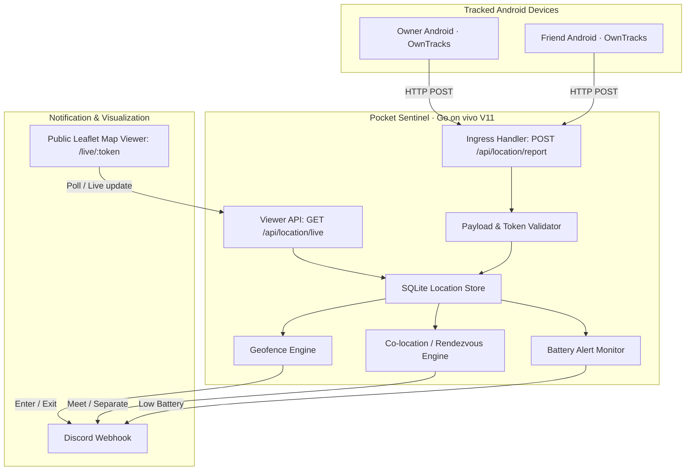

# Location & Rendezvous Tracker — Implementation Plan

## 1. Architecture



---

## 2. Module Map

```text
modules/location/
  models.go         OwnTracks payload structs, DB models, settings contracts
  math.go           Pure Go Haversine distance and coordinate math
  store.go          SQLite persistence, last-known positions, geofences, 7-day pruning
  service.go        Orchestrator for Geofence transitions, Co-location, and Battery checks
  handlers.go       Gin HTTP endpoints (Ingress, Settings, Geofences, Live map API)
  notifier.go       Discord notification builder and webhook dispatcher
  math_test.go      Haversine unit tests and coordinate boundary validation
  service_test.go   Hysteresis, cooldown, and state transition test suite
  handlers_test.go  Ingress authentication and API validation tests

modules/dashboard/
  live_map.html     Responsive Leaflet Web Viewer for mobile and desktop
  static/js/components/live-map.js
  static/css/styles.css (or live-map styles)
```

---

## 3. Integration Plan

1. **Database & Configuration:**
   - Add `LOCATION_SECRET_TOKEN` and `LOCATION_VIEWER_TOKEN` to `shared/config/config.go`.
   - Add SQLite table schemas in `shared/db/db.go` under `InitDB()` (using pure-Go `modernc.org/sqlite` with WAL mode).
2. **Spatial Logic & Service:**
   - Implement `math.go` for sub-meter accuracy Haversine calculations.
   - Implement `service.go` encapsulating stateful evaluation:
     - Geofence enter/exit with per-device state.
     - Rendezvous evaluation with 80m enter / 250m exit hysteresis and 5-minute cooldown.
     - Battery threshold detection with 2-hour alert deduplication.
3. **Discord Integration:**
   - Reuse existing `modules/alerts/discord.go` webhook dispatcher pattern.
   - Build clean Markdown messages with emojis, Thai localization, and Bangkok timestamps.
4. **API & Routing:**
   - Register `/api/location/*` in `main.go`.
   - Register `/live/:token` in `modules/dashboard` serving `live_map.html`.
5. **Frontend Viewer:**
   - Load Leaflet.js via CDN (or local vendor) without Node build tools.
   - Strictly declare Leaflet instances outside Alpine reactive proxies to prevent TypeError proxy corruption.
   - Render dual pins, live distance line, geofences, and battery telemetry.
   - Bump Service Worker `CACHE_NAME` in `modules/dashboard/sw.js`.

---

## 4. Test Strategy

- **Haversine Math Verification:**
  - Zero distance (same coordinate = 0.0m).
  - Known reference distances (e.g. Siam Paragon to CentralWorld = ~650m).
  - Equator / Prime Meridian boundary crossings.
- **Co-location State Machine:**
  - Approaches from 500m $\rightarrow$ 150m $\rightarrow$ 75m: Triggers "พบกันแล้ว" at $\le 80$m.
  - Fluctuates 85m $\leftrightarrow$ 110m (GPS Jitter): Does NOT trigger "แยกย้ายแล้ว".
  - Departs 120m $\rightarrow$ 260m: Triggers "แยกย้ายแล้ว" at $\ge 250$m.
  - Rapid oscillation within 5 minutes: Cooldown suppresses duplicate Discord alerts.
- **Geofence State Transitions:**
  - Device enters geofence radius: Emits Enter event.
  - Device remains inside: Suppressed.
  - Device exits geofence radius: Emits Exit event.
- **Ingress Security:**
  - Rejection of invalid token (HTTP 401).
  - Rejection of invalid device ID (only `me` and `friend` allowed).
  - Validation of latitude/longitude boundaries.
- **7-Day Retention:**
  - Prunes records older than 7 days without locking SQLite database.

---

## 5. Rollout Strategy

1. **Deploy to vivo V11:**
   - Build cross-compiled ARM64 Android Go binary.
   - Sync and reload PM2 via `deploy-v11.sh`.
2. **Setup Device 1 (Owner):**
   - Install OwnTracks on Android phone.
   - Set HTTP endpoint: `https://spindle-said-hemstitch.ngrok-free.dev/api/location/report?device=me&token=SECRET`.
   - Verify first ping in SQLite and logs.
3. **Setup Device 2 (Friend):**
   - Set HTTP endpoint: `https://spindle-said-hemstitch.ngrok-free.dev/api/location/report?device=friend&token=SECRET`.
   - Verify second ping in SQLite.
4. **Live Verification:**
   - Open `/live/:viewer_token` on mobile browser.
   - Confirm both pins render and live distance updates smoothly.
   - Verify test Discord alert on rendezvous or geofence test event.
