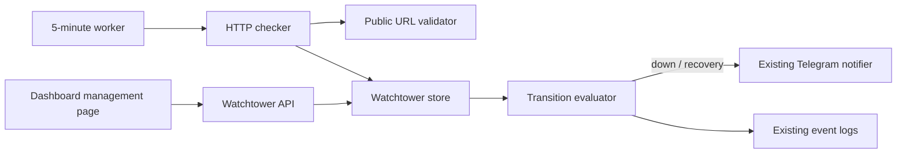

# Personal Watchtower — Implementation Plan

## Architecture



## Module map

```text
modules/watchtower/
  models.go       configuration, check result, and state contracts
  validator.go    public HTTP(S) URL and DNS/IP validation
  checker.go      timeout, retry, status evaluation, latency measurement
  store.go        SQLite persistence, queries, and seven-day retention
  service.go      scheduler-facing state transitions and notifications
  handlers.go     Gin API and PIN guard
  *_test.go       unit and integration coverage

modules/dashboard/
  index.html      compact Watchtower summary and management launch point
  watchtower.html dedicated management page
  static/js/components/watchtower.js
  static/css/styles.css
```

## Integration plan

1. Add `WATCHTOWER_PIN` to typed configuration. It has no unsafe default: watchtower mutations return unavailable until configured.
2. Add tables and indexes in `shared/db`, then add the Watchtower module and register routes from `main.go`.
3. Create a worker owned by `App` that schedules enabled watchers with 0–60 seconds of startup jitter and then on the five-minute schedule. Limit concurrent requests to three and configured watchers to 25. Add seven-day history cleanup to the existing retention lifecycle.
4. Reuse the existing Telegram notifier and event logger through small local interfaces. Do not import dashboard or bot packages into Watchtower.
5. Add the Dashboard summary and management page using Alpine primitive state only. Store no browser File, Chart, or other complex instance in Alpine data.
6. Update the service worker cache version whenever dashboard assets change.

## Test strategy

- URL validation: schemes, malformed URLs, localhost, literal private IPs, DNS names resolving to private IPs, multi-address hosts, and connection-time rebinding defenses.
- Checker: successful status, unexpected status, timeout, retry success, retry exhaustion, no redirect following.
- State: first success, three-cycle failure, duplicate suppression, recovery, pause, resume, edit reset, diagnostic-only manual checks, and restart persistence.
- Store: CRUD, status summary, bounded history, cascading watcher deletion, and seven-day cleanup.
- Handlers: PIN enforcement, invalid payloads, create-and-check behavior, and read-only endpoints.
- Regression: `go test ./...` plus browser-level visual review on small mobile widths before deployment.

## Rollout

1. Deploy with `WATCHTOWER_PIN` configured but no watcher.
2. Add Todo FM in Dashboard and confirm immediate result.
3. Verify Telegram delivery with a deliberate temporary expected-status mismatch, then restore status `200` and observe one recovery.
4. Confirm memory remains under the project budget and inspect PM2 logs without streaming.
