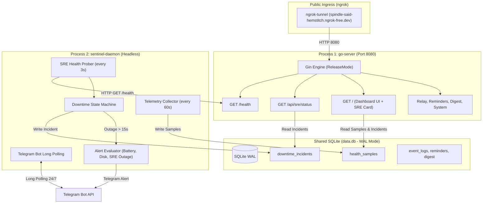

# Decoupled SRE Sentinel — Implementation Plan

## 1. Architecture Flow



---

## 2. Module & Binary Map

```text
cmd/
  server/
    main.go           Entry point for Web App (Port 8080, Gin, Dashboard, Relay, Reminders)
  sentinel/
    main.go           Entry point for Sentinel Daemon (Prober, Bot Poller, Telemetry Worker)

modules/
  sre/
    prober.go         HTTP health check prober with timeout & exponential backoff
    tracker.go        State machine (UP -> DOWN -> UP), downtime calculation in ms
    store.go          SQLite repository for downtime_incidents
    handlers.go       Gin API endpoints (/api/sre/status, /api/sre/incidents)
    models.go         Incident and status data contracts
  dashboard/
    dashboard.html    Updated with Apple HIG-compliant SRE Card
    static/js/components/sre.js   Live SRE status and downtime history polling

shared/
  db/
    db.go             Added downtime_incidents table creation and migrations

ecosystem.config.js   Updated PM2 config with go-server, sentinel-daemon, ngrok-tunnel
scripts/
  deploy.sh           Updated deploy script: builds both binaries, defaults to restart go-server
```

---

## 3. Implementation Sequence

### Phase 1: Storage & SRE Engine Core (`shared/db`, `modules/sre`)
1. Extend `shared/db/db.go` to create `downtime_incidents` table and indexes with WAL pragmas.
2. Implement `modules/sre/store.go` with methods:
   - `RecordIncidentStart(reason) (int64, error)`
   - `RecordIncidentRecovery(id, durationMs) error`
   - `GetRecentIncidents(limit) ([]Incident, error)`
   - `Get24hAvailability() (AvailabilityStats, error)`
3. Implement `modules/sre/tracker.go`: State machine evaluating probe results, timing down intervals, and triggering alerts when downtime exceeds 15 seconds.
4. Implement `modules/sre/prober.go`: Periodic HTTP client probing `http://127.0.0.1:8080/health`.

### Phase 2: Sentinel Daemon Binary (`cmd/sentinel`)
1. Create `cmd/sentinel/main.go` pulling in:
   - `setupAndroidDNS()`
   - Shared DB connection (`data.db`)
   - `modules/sre` (Prober + Tracker)
   - `modules/telemetry` (Collector worker)
   - `modules/alerts` (AlertManager with Telegram notifier)
   - `modules/bot` (Poller + Router)
2. Update `modules/bot/router.go` to handle `/reboot` by executing `pm2 restart go-server` via `bot.SafeExecutor`, and `/reboot sentinel` for daemon restart.

### Phase 3: Web App Binary Refactoring (`cmd/server`)
1. Create `cmd/server/main.go` (or refactor root `main.go`):
   - Retain Gin HTTP listener on `PORT` (8080).
   - Retain `dashboard`, `relay`, `reminders`, `digest`, `system`, and `logs`.
   - Remove duplicate background bot poller and telemetry worker (now hosted by Sentinel).
   - Register `GET /health` and `/api/sre/*` routes.
   - Read telemetry samples directly from `health_samples` written by Sentinel.

### Phase 4: Dashboard UI SRE Observability Card
1. Add an Apple HIG SRE Card to `modules/dashboard/dashboard.html`:
   - Live availability badge: `🟢 99.98% 24h Uptime`
   - Status: `Operational` / `Deploying` / `Degraded`
   - Last Restart/Downtime: `2.1s duration (14m ago)`
2. Add `modules/dashboard/static/js/components/sre.js` with Alpine.js reactive store (respecting frontend proxy guardrails).
3. Bump Service Worker cache version in `modules/dashboard/static/sw.js`.

### Phase 5: PM2 Orchestration & Deploy Pipeline
1. Update `ecosystem.config.js` to define both `go-server` and `sentinel-daemon`.
2. Update `scripts/deploy.sh`:
   - Cross-compile both `server` and `sentinel` ARM64 binaries.
   - Default deploy action: `pm2 restart go-server --update-env` (Sentinel continues running).
   - Add `--all` flag: restarts both `go-server` and `sentinel-daemon`.
   - Add `--sentinel-only` flag for daemon-only deployments.

---

## 4. Verification Plan & Concrete Evidence Criteria

| Verification Step | Command / Procedure | Expected Result / Evidence |
|---|---|---|
| **1. Unit & Concurrency Tests** | `go test -v ./modules/sre/... ./shared/db/...` | 100% pass, SQLite WAL concurrent read/write test passes with zero locked errors |
| **2. Binary Cross-Compilation** | `CGO_ENABLED=0 GOOS=android GOARCH=arm64 go build -o server ./cmd/server && CGO_ENABLED=0 GOOS=android GOARCH=arm64 go build -o sentinel ./cmd/sentinel` | Clean exit 0, both ELF 64-bit ARM binaries produced under 25MB each |
| **3. Process Separation on v11** | `ssh v11 "pm2 ls"` | Both `go-server` (online) and `sentinel-daemon` (online). Combined RAM < 30MB |
| **4. Redeploy Downtime Proof** | `ssh v11 "pm2 restart go-server"` followed by inspecting SQLite | New row in `downtime_incidents` with `duration_ms` between 500ms and 3500ms, status `recovered` |
| **5. Zero-Spam Normal Deploy** | Deploy with restart duration < 15s | Zero Telegram messages sent |
| **6. Critical Outage Detection** | `ssh v11 "pm2 stop go-server"` and wait 16 seconds | Telegram receives `🚨 CRITICAL SRE ALERT: Web App is DOWN!` at T+15s |
| **7. Recovery Notification** | `ssh v11 "pm2 start go-server"` | Telegram receives `✅ Web App RECOVERED! Downtime: XX.X seconds` |
| **8. Emergency Bot Availability** | While `go-server` is stopped, send `/ping` and `/status` in Telegram | Telegram bot replies immediately with status card showing `App: Offline, Sentinel: Online` |
| **9. Dashboard Card Inspection** | Open `https://spindle-said-hemstitch.ngrok-free.dev` | SRE Status Card renders 24h Uptime %, last restart duration, and live badge |

---

## 5. Rollback Strategy

If an unexpected regression occurs on vivo V11:
1. **Quick Rollback:** Run `git checkout main && ./scripts/deploy.sh` (or deploy prior known-good binary `server.bak`).
2. **PM2 Reversion:** In `ecosystem.config.js`, remove `sentinel-daemon` and restart PM2.
3. **Database Safety:** Since all schema changes use `CREATE TABLE IF NOT EXISTS`, database rollback is non-destructive and requires no data drops.
